# VFX for Claude Code

40 video effects (transitions, animated titles, looks and overlays) written as plain Python. Ask Claude Code for one in your own words, "put a light leak between these two clips" or "glitch title on the hook", and it finds the effect, runs it on your footage and gives you the file.

Every effect was rebuilt frame by frame from real short-form edits: the timing, the curves and the number of frames match the reference, not a guess. No After Effects, no Premiere, no plugins. Each one renders a normal MP4 that you drop into any editor.

<p>
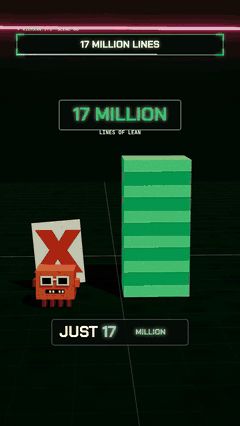
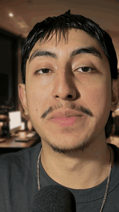
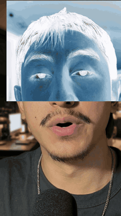

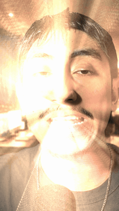
</p>

**Browse all of them:** [the gallery](https://robj1925.github.io/vfx-for-claude-code/) (search box, every demo playing), or scroll to [the effect list](#the-effects).

**Want the full AI editing workflow these effects plug into?** Scripts, cuts, captions, graphics and thumbnails, step by step, plus help when you get stuck: 🎞️ [AI Academy on Skool](https://www.skool.com/ai-academy-with-robby-6849/about)

## What you need

- macOS (the fonts and the person matte use Apple system tools)
- Python 3.9 or newer, with `numpy` and `Pillow`
- `ffmpeg` (`brew install ffmpeg`)
- Xcode Command Line Tools (`xcode-select --install`), only for the effects that cut out a person (T02, T06, FX01, FX03, FX07). The matte tool builds itself on first use.
- [Claude Code](https://claude.com/claude-code), if you want to ask for effects in plain words

## Install

```bash
git clone https://github.com/Robj1925/vfx-for-claude-code.git
cd vfx-for-claude-code
pip3 install -r requirements.txt
./install.sh        # adds the Claude Code skill (a link to this folder)
```

## Use it with Claude Code

Open Claude Code anywhere and ask:

- "Add the glow transition between intro.mov at 3.2 s and broll.mov at 0.5 s"
- "Put a glitch title that says Big News on the first 2 seconds of hook.mov"
- "Give my talking head clip the film look and show me a before and after"
- "Which effects do you have for a hook?"

The skill tells Claude Code how to search the catalog, run the effect, make a short preview first, and tell you where the file is.

## Use it without Claude Code

```bash
python3 find.py glow             # search by any word: name, other names, look, mood
python3 find.py --all            # list every effect
python3 find.py glitch --open    # also open the demo GIF
```

Each result prints the command to run, for example:

```bash
python3 effects/transitions.py leak A.mov --cut 3.2 B.mov --b-in 0.5 --look warm -o out.mp4
python3 effects/text_fx.py glitch "Big News" --bg hook.mov --at 0 --y 0.13 -o title.mp4
python3 effects/film_look.py clip.mov --dur 3 --compare -o graded.mp4
```

Every script has `--help`. Outputs are video only (no audio), so keep your original audio track under them. Output is 1080x1920 at 30 fps by default (vertical Shorts, Reels and TikTok). Use `--w 1920 --h 1080` for landscape (the demos and timings are tuned for vertical). The four titles in `effects/text_fx.py` also take `--alpha title.mov` for a transparent version you can put on top in your own editor.

## The effects

IDs: **T** = transition (joins two clips), **TX** = title or text, **FX** = look or overlay on one clip.

<!-- EFFECTS:START -->
### Transitions (8)

Joins between two clips.

| Demo | Effect | Look and best use |
|---|---|---|
|  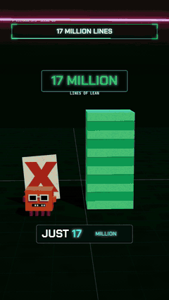 | **T01** Light leak glow transition<br><sub>also: light leak, glow, flare, overlay transition, film burn</sub> | A soft coloured glow swells over the end of clip A, peaks on the cut, washes over clip B and is gone 5 frames later.<br>**Best for:** energy cut between b-roll shots, hook into the body, beat drops<br>`python3 effects/transitions.py leak A.mov --cut <s in A> B.mov --b-in <s in B> --look warm|prism -o out.mp4` |
| 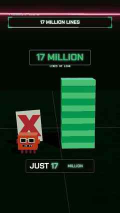 | **T02** Roto silhouette step-in transition<br><sub>also: roto, rotoscope, silhouette, cutout, step in</sub> | The subject's outline from the next shot appears over clip A as a flat cream silhouette for 3 frames, then 1 frame in true colour, then the cut. The subject seems to step into the shot.<br>**Best for:** b-roll or a graphic into the talking head; works best when B is the subject on camera<br>`python3 effects/transitions.py roto A.mov --cut <s in A> B.mov --b-in <s in B> -o out.mp4` |
| 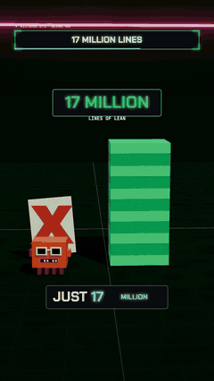 | **T03** Blur blink camera transition<br><sub>also: blur, radial blur, zoom blur, motion blur, blink</sub> | Zoom blur and a dark vignette build over 3 frames, peak on the cut and fade over 3 frames: a camera blink.<br>**Best for:** cinematic cut between two moving shots, scene change, time jump<br>`python3 effects/transitions.py blink A.mov --cut <s in A> B.mov --b-in <s in B> -o out.mp4` |
| 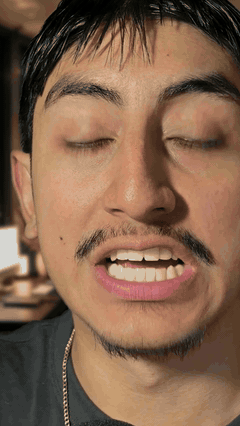 | **T04** Zoom-out camera move transition<br><sub>also: zoom out, camera move, punch out, zoom transition, transform transition</sub> | Clip A sits zoomed in (1.3x), then rushes out through the cut in about 2 motion-blurred frames and clip B lands wide and settles in 3 frames. Optional word in the gradient glow style rides the move.<br>**Best for:** cut from a close shot to a wide shot, question or reaction moments<br>`python3 effects/transitions.py zoomout A.mov --cut <s> B.mov --b-in <s> -o out.mp4 [--text "What"]` |
| 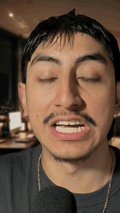 | **T05** Focus pull camera blur transition<br><sub>also: focus pull, camera blur, out of focus, defocus, lens blur</sub> | A subtle push in, a light softening just before the cut and for 2 frames after it, like a lens briefly losing focus. Quiet, not a heavy blur.<br>**Best for:** calm or cinematic cuts, mood changes, b-roll sequences<br>`python3 effects/transitions.py focus A.mov --cut <s> B.mov --b-in <s> -o out.mp4` |
|  | **T06** White flash subject transition<br><sub>also: white flash, flash in, subject flash, silhouette flash, appear</sub> | the subject's frozen outline from the next shot appears over clip A as a warm white silhouette and fades into full colour over 5 frames, then the cut. Softer cousin of T02.<br>**Best for:** the subject appearing in a place, scene to scene with the same framing<br>`python3 effects/transitions.py whiteflash A.mov --cut <s> B.mov --b-in <s> -o out.mp4` |
| 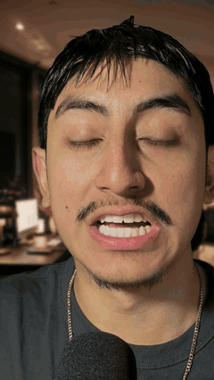 | **T07** Punch-in flash transition<br><sub>also: punch in, punch zoom, flash cut, jump zoom, red flash cut</sub> | The end of a shot washes to white from the left over 2 frames, one red-tinted frame hits, then the next shot cuts in tighter (about 1.15x) and holds.<br>**Best for:** jump cuts in a talking head, beat hits, moving from a statement to the punchline<br>`python3 effects/transitions.py punch A.mov --cut <s> B.mov --b-in <s> -o out.mp4` |
|  | **T08** CRT white flash reset<br><sub>also: crt flash, white flash, flash reset, punch out, screen flash</sub> | A punched-in shot cuts to 4 frames of white with faint CRT scan lines, then comes back at normal framing: a clean way to undo a punch-in.<br>**Best for:** podcast and talking-head clips, after a punch-in, between two lines<br>`python3 effects/transitions.py crt A.mov --cut <s> B.mov --b-in <s> -o out.mp4` |

### Titles and text (15)

Animated words over a clip.

| Demo | Effect | Look and best use |
|---|---|---|
|  | **TX01** Fade-up stacked title<br><sub>also: fade up, fade text, apple text, minimal text, stacked words</sub> | White Helvetica words stacked tight and overlapping, each fading toward its bottom, rising in one by one fast then landing slow.<br>**Best for:** calm hook title, Apple style statement, chapter title<br>`python3 effects/text_fx.py fade "The Fade Text Effect" --bg clip.mov --at <s> --y 0.15 -o out.mp4 [--alpha text.mov]` |
| 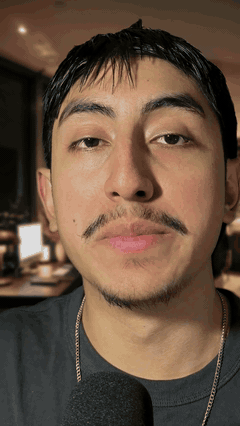 | **TX02** Premium 3D serif title<br><sub>also: premium text, 3d text, emboss, bevel, bump map</sub> | Embossed Apple Garamond italic: first word grey metal, second word orange red, lit from the top left. The demo uses Apple Garamond; without it the effect falls back to Baskerville.<br>**Best for:** money or luxury words, two-word titles, product names<br>`python3 effects/text_fx.py premium "Premium|Text" --bg clip.mov --at <s> --y 0.12 -o out.mp4 [--alpha text.mov]` |
|  | **TX03** Glitch flicker title<br><sub>also: glitch, flicker, strobe text, chrome text, y2k</sub> | Chrome italic words that flicker on and off while rising with motion blur, stacked and overlapping.<br>**Best for:** hype hook, tech or AI words, fast intros<br>`python3 effects/text_fx.py glitch "Glitch Text Effect" --bg clip.mov --at <s> --y 0.13 -o out.mp4 [--alpha text.mov]` |
| 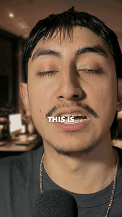 | **TX04** Bounce captions elastic pop<br><sub>also: bounce captions, bouncy text, elastic, pop captions, one word captions</sub> | One or two white heavy caps words per card (4 to 8 characters), each new card pops in at 80 % size, overshoots to 106 % and settles at 100 % by the third frame.<br>**Best for:** talking-head captions for the whole video, energetic delivery<br>`python3 effects/bounce_captions.py --bg clip.mov --at <s> --text "your words" -o out.mp4  (or --words words.json with real word times)` |
| 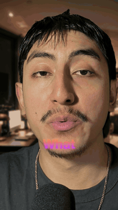 | **TX05** Gradient glow rising title<br><sub>also: gradient text, glow text, orange purple text, neon text, rising text</sub> | Helvetica bold words with an orange to purple gradient and a soft glow, rising slowly into place over the whole clip (fast start, slow landing).<br>**Best for:** short spoken questions or punchlines, the word that rides T04<br>`python3 effects/text_fx.py gradglow "What are you doing" --bg clip.mov --at <s> --y 0.6 -o out.mp4 [--alpha text.mov]` |
|  | **TX06** Word slide-up title<br><sub>also: word slide, slide up text, apple text, sf pro, follower</sub> | SF Pro words slide up into place one after another (each word starts about halfway through the one before), fading in over 7 frames.<br>**Best for:** clean captions or titles, Apple style<br>`python3 effects/hook_fx.py wordslide clip.mov --at <s> --dur 3 --text "Your words" --y 0.5 -o out.mp4` |
| 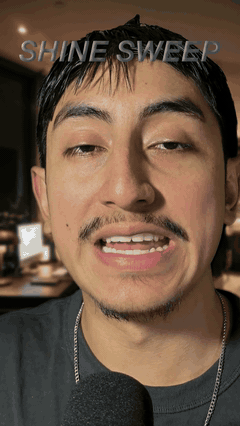 | **TX07** Bevel shine sweep title<br><sub>also: shine, sweep, light sweep, bevel, metal text</sub> | Bevelled grey metal italic letters with a highlight that runs across them about every half second, again and again.<br>**Best for:** premium product or brand names, reveal words<br>`python3 effects/shine_fx.py sweep "SHINE SWEEP" --bg clip.mov --at <s> --dur 1.5 --y 0.12 -o out.mp4` |
| 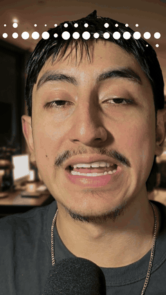 | **TX08** Halftone dots resolve title<br><sub>also: halftone, dots, rasterize, dot text, pixel to text</sub> | The words start as one row of big white dots that shrink and multiply until the clean text appears.<br>**Best for:** tech or reveal titles, intros<br>`python3 effects/shine_fx.py halftone "Your words" --bg clip.mov --at <s> --dur 1.8 --y 0.12 -o out.mp4` |
| 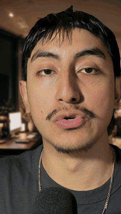 | **TX09** 3D camera fly-through text<br><sub>also: 3d text, camera text, fly through, depth text, 3d camera</sub> | Lines of text float at different depths, alternating left and right; the camera creeps forward so each line grows, slides off the edge and goes soft as it passes, while the video behind grows slowly.<br>**Best for:** hooks with 2 or 3 short phrases, statement openers<br>`python3 effects/camera3d_text.py clip.mov --at <s> --dur 3.2 --lines "built in code|no plugins|just Python" -o out.mp4` |
| 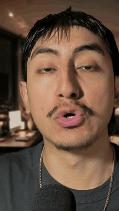 | **TX10** Apple bounce rise<br><sub>also: apple, apple style, bounce, overshoot, card rise</sub> | A title (gradient with glow) or any image card, tilted 2.6 degrees, rises from low in the frame, overshoots a little, dips and settles, like Apple's product reveals.<br>**Best for:** product or feature reveals, screenshots and cards, 'the all new' style titles<br>`python3 effects/apple_bounce.py --bg clip.mov --at <s> --dur 2.2 --text "Introducing" -o out.mp4  (or --image card.png)` |
| 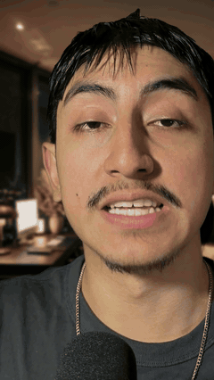 | **TX11** Blur up slide words<br><sub>also: blur up slide, blur slide, cinematic text, words blur in, soft rise</sub> | Each word rises a little from below, out of focus, and sharpens as it fades in; the next word starts about halfway through the one before; a faint softness stays.<br>**Best for:** cinematic captions and titles over b-roll<br>`python3 effects/hook_fx.py blurslide clip.mov --at <s> --dur 2.4 --text "Your words" --y 0.72 --size 90 -o out.mp4` |
| 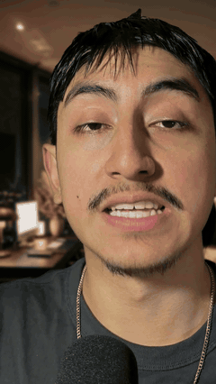 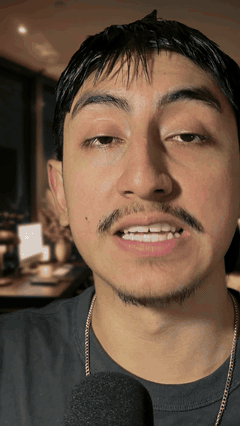 | **TX12** Continuous slide through<br><sub>also: continuous slide, slide through, pass through text, drift text, ticker</sub> | A word whips in from the left, slows and drifts through the middle without stopping, then eases off to the right.<br>**Best for:** passing statements, lists of words, rhythm text<br>`python3 effects/hook_fx.py continuous clip.mov --at <s> --dur 2.4 --text "Continuous" --y 0.72 -o out.mp4` |
| 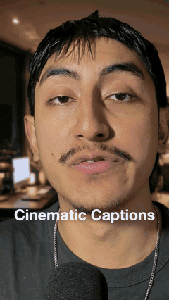 | **TX13** Selection highlight sweep<br><sub>also: highlight, selection, marker sweep, text highlight, cursor sweep</sub> | A dark-blue rounded bar sweeps across the line like a text cursor, leaving a pale-blue highlight box behind it; the words inside turn pale blue, with a soft glow.<br>**Best for:** emphasising a caption or key phrase, revealing a name or logo<br>`python3 effects/caption_fx.py highlight "Cinematic Captions" --bg clip.mov --at <s> --dur 1.4 --y 0.72 -o out.mp4` |
|  | **TX14** Word drop stop-motion<br><sub>also: word drop, drop down, stop motion, choppy text, falling words</sub> | Words fall into place one after another from above, fading in, and the motion steps every second frame like stop motion.<br>**Best for:** captions with a handmade feel, client reels<br>`python3 effects/caption_fx.py dropstop "Your words" --bg clip.mov --at <s> --dur 2.2 --y 0.72 -o out.mp4` |
|  | **TX15** Shaky erode rise title<br><sub>also: shaky text, erode, handwritten, stop motion text, jitter</sub> | Handwritten letters start as thin strokes and thicken in a few choppy steps (held 4 frames each) while each letter jitters slightly up and down, and the line rises into place.<br>**Best for:** playful, handmade or vlog-style titles<br>`python3 effects/caption_fx.py shakyerode "Custom Title" --bg clip.mov --at <s> --dur 2 --y 0.72 -o out.mp4` |

### Looks and overlays (17)

Effects on one clip.

| Demo | Effect | Look and best use |
|---|---|---|
|  | **FX01** Box flash invert boxes<br><sub>also: box flash, invert box, negative box, difference box, flash box</sub> | Rectangles of the picture flip to a photo negative for 5 or 6 frames at a time: the head, a sky corner, a wide band, a 1-frame thin bar, sometimes two boxes at once or the whole frame, with 8-frame gaps.<br>**Best for:** fast b-roll montages, hook energy, highlighting a face or object for a beat<br>`python3 effects/box_flash.py clip.mov --at <s> --dur 3 -o out.mp4 [--boxes boxes.json] [--mode difference|exclusion]` |
| 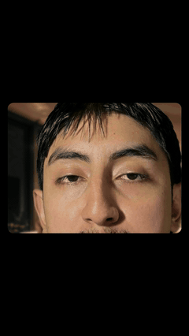 | **FX02** Four by three rounded window<br><sub>also: 4:3, 4x3, four by three, aspect ratio, rounded window</sub> | The clip plays inside a 4:3 window with small rounded corners (about 3 % of the frame width), centred on black or any colour.<br>**Best for:** b-roll or screen clips in a vertical Short, a framed documentary look<br>`python3 effects/window_43.py clip.mov --at <s> --dur 3 -o out.mp4 [--focus 0.32] [--radius 0.06] [--bg 0,0,0]` |
| 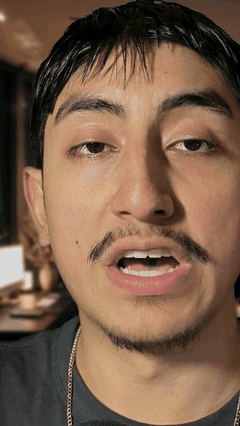 | **FX03** Face lock follow stabilize<br><sub>also: face lock, follow, stabilize, planar tracker, head lock</sub> | The head stays fixed in the frame while the background moves around it, zoomed in so no black edges show.<br>**Best for:** walking or handheld shots of the subject, b-roll montages, pairs well with the box flash<br>`python3 effects/face_lock.py clip.mov --at <s> --dur 3 -o out.mp4 [--zoom 1.18]` |
| 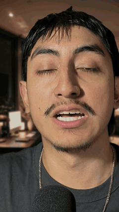 | **FX04** Super slow motion optical flow<br><sub>also: slow motion, slowmo, slo mo, optical flow, retime</sub> | Footage slowed about 12x with new in-between frames, so it stays smooth.<br>**Best for:** b-roll under the voice so viewers can take in the shot; dramatic moments<br>`python3 effects/slowmo.py clip.mov --at <s> --src-dur 0.33 --factor 12 -o out.mp4` |
| 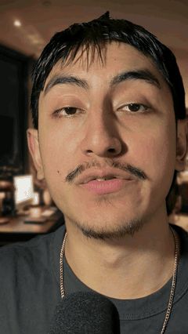 | **FX05** REC recording overlay<br><sub>also: rec, record, recording, camcorder, red dot</sub> | A small white REC with a red dot, held over the whole video; it flickers on at the start with the same frames as the glitch title.<br>**Best for:** vlog or behind-the-scenes feel, montages; pairs well with the box flash<br>`python3 effects/rec_overlay.py clip.mov --at <s> --dur 6 -o out.mp4 [--x 0.5 --y 0.5] [--size 70] [--no-flicker]` |
| 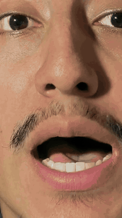 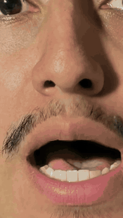 | **FX06** Hook zoom-out intro<br><sub>also: hook zoom, zoom out intro, punch out, intro zoom, opening zoom</sub> | The first shot starts zoomed in 2.5x and snaps most of the way back in about 4 frames with motion blur, then glides the last bit over 2 seconds.<br>**Best for:** the first 2 seconds of every video<br>`python3 effects/hook_fx.py hookzoom clip.mov --at <s> --dur 3 -o out.mp4` |
| 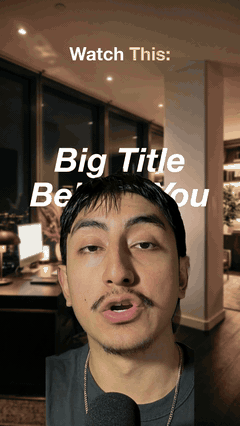 | **FX07** Text behind subject<br><sub>also: text behind, behind the person, rotoscope text, magic mask text, depth text</sub> | Big bold italic words sit behind the subject (the subject passes in front of them), with an optional small title on top in front of the subject, last word in lime.<br>**Best for:** hook titles, walk-in shots, thumbnails come alive (needs space around the person: in a tight close-up the head hides the title)<br>`python3 effects/hook_fx.py behind clip.mov --at <s> --dur 3 --text "Big Title|Behind You" --front "Watch This:" --y 0.42 --size 150 -o out.mp4` |
| 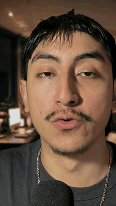 | **FX08** Stutter push-in<br><sub>also: stutter, glitch repeat, frame repeat, stuck frame, loop frames</sub> | One 2-frame slice repeats again and again (a stuck, glitchy moment) while the picture rushes in and then creeps closer.<br>**Best for:** a word where the audio glitches, beat hits, emphasis<br>`python3 effects/strobe_fx.py stutter clip.mov --at <s> --dur 1.6 -o out.mp4 [--zoom 1.28]` |
| 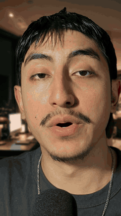 | **FX09** Red flash strobe<br><sub>also: red flash, strobe, flash cuts, darken red, linear dodge glow</sub> | Two shots cut in 2-frame slices, alternating; some slices glow hot, others turn red. Trippy strobe on a beat.<br>**Best for:** music drops, intense moments, montage peaks<br>`python3 effects/strobe_fx.py redflash A.mov --at <s> B.mov --b-at <s> --dur 2 -o out.mp4` |
|  | **FX10** Light rays wipe<br><sub>also: light rays, god rays, microwaves, beams, rays burst</sub> | A strong white burst of rays washes over the shot from the bright areas and slowly pulls back over about 2 seconds.<br>**Best for:** dramatic openings, reveals, soft transitions<br>`python3 effects/shine_fx.py rays "" --bg clip.mov --at <s> --dur 2.4 -o out.mp4` |
| 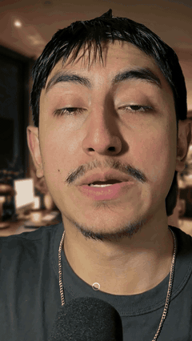 | **FX11** Liquid glass pill<br><sub>also: liquid glass, glass pill, ui animation, apple glass, glass button</sub> | A small glass ball rises under the words, then stretches into a rounded glass pill around them; the picture bends at its edges and a thin bright rim catches the light.<br>**Best for:** UI-style titles, key words, buttons, Apple style intros<br>`python3 effects/liquid_glass.py clip.mov --at <s> --dur 2 --text "In Seconds" --y 0.72 -o out.mp4` |
| 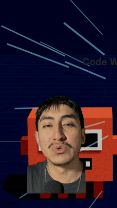 | **FX12** 3D parallax collage pan<br><sub>also: parallax, 3d collage, documentary 3d, 2.5d, camera truck</sub> | Cut-out layers (background, a person, objects, text) sit at different depths; the camera trucks sideways and pushes in a little, so near layers slide past fast and far ones slowly, and text slides in from the side.<br>**Best for:** documentary or story openers, turning stills and cut-outs into a 3D scene<br>`python3 effects/parallax_collage.py --layers layers.json --dur 3 [--truck 1.3] -o out.mp4` |
|  | **FX13** Aesthetic moving gradient background<br><sub>also: background, gradient background, noise background, aesthetic, grainy gradient</sub> | A slow-drifting background: deep black on one side melting into grainy royal blue, with film grain. Any 3 colours.<br>**Best for:** the plate behind titles, cards and screenshots in faceless or aesthetic reels<br>`python3 effects/noise_bg.py --dur 4 -o bg.mp4 [--colors "0,0,0;18,45,150;70,110,215"] [--rate 0.06]` |
|  | **FX14** Screen replacement corner pin<br><sub>also: screen replacement, corner pin, planar tracker, put a screenshot on a laptop, phone screen</sub> | A screenshot or clip is pinned into a laptop, phone or monitor screen in a shot, following its corners, toned a little darker and softer so it sits in the scene.<br>**Best for:** showing a website, app or screenshot on a real device in b-roll or a 3D scene<br>`python3 effects/corner_pin.py shot.mov --at <s> --dur 2 --content screenshot.png --corners pins.json -o out.mp4` |
| 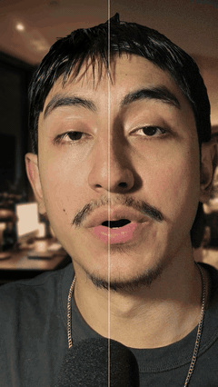 | **FX15** Film look grade<br><sub>also: film look, cinematic grade, 35mm, film look creator, halation</sub> | A 35 mm style grade: gently lifted blacks, soft highlight roll-off, slightly muted olive greens, warm skin, a faint warm glow around bright edges (halation), a half-strength vignette and fine grain.<br>**Best for:** making talking heads and b-roll feel cinematic and consistent<br>`python3 effects/film_look.py clip.mov --at <s> --dur 3 -o out.mp4 [--strength 1] [--grain 0.035] [--halation 0.18] [--vignette 0.5] [--compare]` |
| 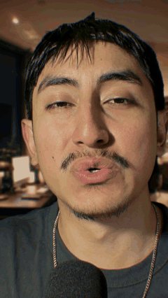 | **FX16** Chromatic aberration<br><sub>also: chromatic aberration, rgb split, color fringe, lens fringe, split channels</sub> | Thin red and cyan fringes along edges that grow toward the corners, like a cheap lens; the centre stays clean.<br>**Best for:** a finishing touch on a grade, gritty or music-video looks<br>`python3 effects/chromatic.py clip.mov --at <s> --dur 3 -o out.mp4 [--amount 0.006]` |
| 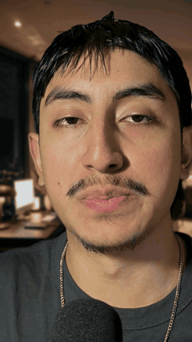 | **FX17** Vignette blink flicker<br><sub>also: vignette blink, blink, flicker vignette, dark edges flash, premium flicker</sub> | Dark soft edges flash on for a frame or two at a time, a few times, then the picture is clean again: a subtle blink.<br>**Best for:** hook openers and title moments, a premium feel on b-roll<br>`python3 effects/strobe_fx.py vigblink clip.mov --at <s> --dur 1 -o out.mp4` |

<!-- EFFECTS:END -->

## How it is built

| Path | What it holds |
|---|---|
| `catalog.json` | the source of truth: ID, name, other names, look, best use, mood, length in frames, command, demo |
| `find.py` | search the catalog |
| `effects/*.py` | the effects (numpy + Pillow, frames piped through ffmpeg) |
| `lib/fx.py` | shared code: frame read and write, eased keyframes, zoom blur, lens distortion, vignette masks, person matte |
| `lib/segment.swift` | Apple Vision person segmentation, compiled on first use |
| `docs/gifs/` | one demo GIF per effect |
| `docs/index.html` | the gallery (built by `make_gallery.py`) |
| `skills/vfx-for-claude-code/SKILL.md` | the Claude Code skill |

The method for each effect: watch the reference edit frame by frame (duplicate frames removed with ffmpeg `mpdecimate`), read the settings, write down what changes on which frame, then rebuild it in numpy and check the render against the reference frame by frame again. The notes at the top of each effect file say what was measured.

## Add your own effect

1. Write it in `effects/` (copy the shape of an existing file: `read_frames`, change the frames, `Writer`).
2. Add an entry to `catalog.json` with the next ID, a plain name, 6 to 10 other names people might use, the look, best use, mood and the command.
3. Render a short demo and make the GIF: `ffmpeg -i demo.mp4 -vf "fps=30,scale=240:-2:flags=lanczos,split[a][b];[a]palettegen=max_colors=96:stats_mode=diff[p];[b][p]paletteuse=dither=bayer:bayer_scale=5:diff_mode=rectangle" docs/gifs/<ID>-<plain-name>.gif`
4. Run `python3 make_gallery.py` (updates the gallery and the tables in this README).

Pull requests with new effects are welcome.

## Community

Questions, renders to share, or the rest of the pipeline (the Short Form Editor, the Long Form Editor, captions and thumbnails): [AI Academy on Skool](https://www.skool.com/ai-academy-with-robby-6849/about). Every post gets an answer within 24 hours.

## License

MIT. Use the effects in any video, paid or free. The demo footage in `docs/gifs/` is the author's own.
